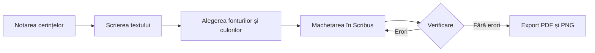

proiect-afis/
│
├── README.md
│
├── imagini/
│   └── diagrama.png
│
└── export/
    ├── proiect.docx
    └── proiect.html
    
---
title: "Proiect afiș – Balul Bobocilor 2026"
author: "ciudoiu roxana – 12A"
date: "2026-11-03"
lang: ro
---

# Proiect afiș – Balul Bobocilor 2026

Acest document prezintă cerințele clientului, datele tehnice, etapele de lucru și verificările necesare pentru realizarea afișului „Balul Bobocilor – Anii '80”.

## 1. Cerințele clientului

- **Client:** Consiliul elevilor al liceului.
- **Eveniment:** Balul Bobocilor 2026.
- **Data:** Vineri, 20 noiembrie 2026.
- **Ora:** 18:00.
- **Locul:** Sala de festivități.
- **Tema:** „Anii '80”.
- **Culori dorite:** mov, roz aprins și galben.
- **Termen de predare:** 6 noiembrie 2026.
- **Număr de exemplare pentru tipar:** 20.
- **Publicare online:** pagina de Instagram a liceului.

**Modificarea titlului:**

Titlul vechi: ~~Bal 2026~~

Titlul nou: **Balul Bobocilor – Anii '80**

## 2. Date tehnice

| Element | Tipar | Ecran |
|:---|:---:|---:|
| Dimensiune | A2 (420 × 594 mm), portret | 1080 × 1350 px |
| Rezoluție | 300 dpi | 96 dpi |
| Model de culoare | CMYK | RGB |
| Format de predare | PDF/X-4 | PNG |

### Formula de calcul a dimensiunii în pixeli

Formula:

\[
P = \frac{L}{25,4} \times R
\]

Unde:

- **P** = dimensiunea în pixeli (px);
- **L** = dimensiunea în milimetri (mm);
- **25,4** = numărul de milimetri dintr-un inch;
- **R** = rezoluția în dpi (puncte pe inch).

### Calculul dimensiunii fotografiei de fundal

Pentru afișul A2, orientare portret:

**Lățime:**

\[
P_l = \frac{420}{25,4} \times 300
\]

\[
P_l = 4960,63 \approx 4961 \text{ px}
\]

**Înălțime:**

\[
P_h = \frac{594}{25,4} \times 300
\]

\[
P_h = 7001,57 \approx 7002 \text{ px}
\]

**Rezultat:** Fotografia de fundal trebuie să aibă minimum **4961 × 7002 pixeli** pentru tipărirea afișului A2 la 300 dpi, fără a lua în calcul eventualele margini de tăiere sau pierderi prin decupare.

### Notă de subsol

Verificarea (*preflight*) este procesul de control al documentului înainte de tipărire, pentru identificarea erorilor precum fonturi lipsă, imagini cu rezoluție insuficientă, culori incorecte sau alte probleme tehnice.

## 3. Etape de lucru

- [x] Notarea cerințelor clientului.
- [ ] Scrierea textului afișului.
- [ ] Alegerea fonturilor și a culorilor.
- [ ] Machetarea în Scribus.
- [ ] Verificarea (preflight).
- [ ] Exportul PDF și PNG.

## 4. Diagrama etapelor

Diagrama logică a procesului de realizare a afișului:

Imaginea diagramei se salvează în folderul `imagini`, cu numele `diagrama.png`.

## 5. Verificare

| Element verificat | Rezultat | Observații |
|:---|:---:|:---|
| Fișierul README.md este complet | Da | Documentul conține toate secțiunile |
| Antetul de metadate este complet | Nu | De completat cu numele și clasa |
| Tabelul cu date tehnice este corect | Da | Are trei coloane |
| Formula și calculele sunt corecte | Da | 4961 × 7002 px |
| Nota de subsol este prezentă | Da | Explică termenul preflight |
| Lista de sarcini este completă | Da | Conține șase etape |
| Diagrama Mermaid este corectă | Da | Conține decizia și revenirea la machetare |
| Imaginea diagramei este inserată | Nu | De adăugat diagrama.png |
| Documentul Word a fost generat | Nu | De verificat |
| Documentul HTML a fost generat | Nu | De verificat |
| Documentele exportate au fost verificate | Nu | De verificat |

---

**Concluzie:** Documentul organizează cerințele pentru realizarea afișului „Balul Bobocilor – Anii '80” și stabilește specificațiile tehnice și etapele necesare pentru obținerea materialelor finale destinate tiparului și publicării online.
